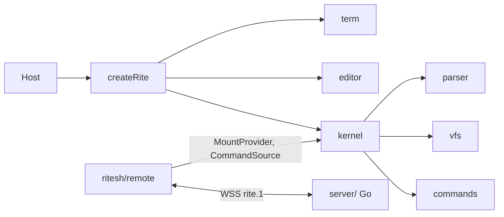

# AGENTS.md

## Project

ritesh is `rite`, a shell for the browser, on xterm.js. A host page embeds it with `createRite`, mounts its own files and commands, and can connect one server over the rite.1 protocol (`ritesh/server`, Go). rite has its own language; it is not bash, zsh, or POSIX.

Design: `docs/specs/2026-11-26-ritesh-design.md` (phase plan at the end). Language: `docs/language.md`. Protocol: `docs/protocol.md`.

## Architecture



- `packages/ritesh/src/contracts.ts`: every type that crosses modules. Modules import only it and their own files (see the import table in the design spec). Only `src/term` imports xterm.
- `packages/ritesh/src/{term,editor,parser,kernel,vfs,commands,eggs,remote}`: one module each.
- `protocol/`: the rite.1 schema, conformance traces, and the test world. `npm run sync:protocol` copies the schema to `server/` and generates `src/remote/protocol.gen.ts`.
- `server/`: Go module `github.com/jarrodb/ritesh/server`.
- `docs/language/cases.jsonl`: language cases; parser and kernel tests read them.

## Setup

```bash
npm ci
```

Node 24, Go 1.25 or newer.

## Run

```bash
npm run build          # dist/: ESM entries, vendor/xterm chunk, rite.bundle.min.js, rite.css
```

## Test

```bash
npm run lint           # eslint, tsc
npm test               # vitest
npm run check:package  # publint, attw, size-limit, pack and import
(cd server && go vet ./... && golangci-lint run && go test -race -count=1 ./...)
```

## Principles

- Library-first, except where the design spec records a decision to own the code (interpreter, line editor, JSON-RPC framing).
- The language and protocol documents are the source of truth; code follows them. Change the document and its cases or traces first.
- Units implementing a wave do not edit `contracts.ts`, `docs/language.md`, or `protocol/`; they report gaps.
- Output reaches xterm only through `term` with a policy (`plain`, `sgr`, `raw`). Server and file content is never `raw`.
- Run linters and tests before completing work.

## Code Conventions

### Git

- Feature branches from master: `feat/`, `fix/`, `chore/`, `hotfix/`.
- Never commit to master. Never push without explicit ask.
- Signed commits. Conventional prefixes: `feat:`, `fix:`, `docs:`, `test:`, `chore:`, `refactor:`.
- Single line, concise, imperative subjects. No Co-Authored-By trailers.
- Squash merge preferred.

### TypeScript

- Strict, `exactOptionalPropertyTypes`, `noUncheckedIndexedAccess`. ESM only.
- TypeScript stays on 6.0 until typescript-eslint supports 7.
- Dependencies pinned to exact versions. xterm and its addons are bundled, never peers.

### Go

- `gofmt`, `go vet`, `golangci-lint run`, `go test -race -count=1 ./...`. Table-driven tests. No `time.Sleep` in tests.

### Testing

- Great coverage is a goal. No sleep-based timing. Browser behavior is tested with Playwright on Chromium, Firefox, and WebKit.

## Releases

Changesets for versions and the changelog. The owner pushes a signed `vX.Y.Z` tag; CI verifies it, publishes to npm with provenance, tags `server/vX.Y.Z`, and checks the CDN bytes. See the design spec.

## README Policy

- For human consumption. Concise. No em-dashes. No AI prose.
- What it is, how to set up, run, and test. Mermaid where it helps.

## Specs

- Design specs: `docs/specs/YYYY-MM-DD-<topic>-design.md`. Marker blocks (`<<<<<<<`, `|||`, `=======`, `>>>>>>>`) in specs are decision records; conflict-marker checks exclude `docs/specs/**` and `docs/plans/**`.
