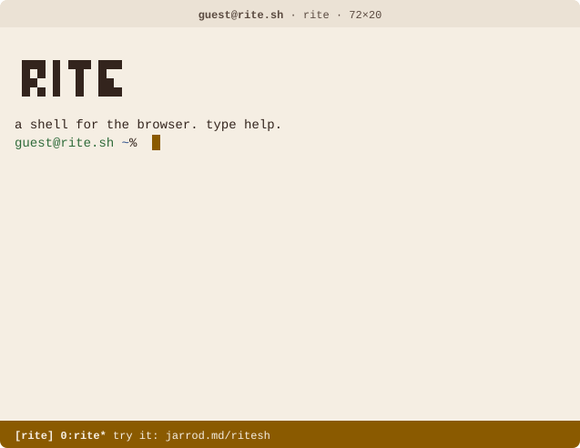
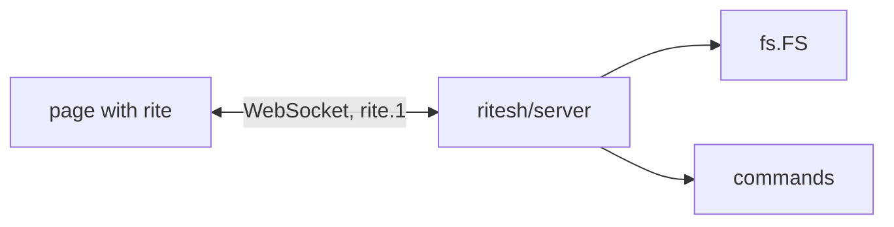

# ritesh

`rite` is a shell for the browser, built on [xterm.js](https://xtermjs.org). Embed it in a page, give it your own files and commands, and optionally connect it to a server.

<a href="https://jarrod.md/ritesh/"><picture>
  <source media="(prefers-color-scheme: dark)" srcset="docs/demo-brass.svg">
  
</picture></a>

**[Try it in your browser.](https://jarrod.md/ritesh/)**

rite has its own small language: quoting, `|`, `&&`, `||`, `;`, redirects into an in-memory filesystem, `$VARS`, globs, and aliases. It is not bash; see [docs/language.md](docs/language.md).

> Status: 0.2.0.

## Use

```sh
npm install riteshjs
```

```ts
import { createRite, defineCommand } from "riteshjs"
import "riteshjs/rite.css"

const hello = defineCommand({
  name: "hello",
  summary: "say hello",
  usage: "hello [name]",
  run: async (p) => { await p.out(`hello, ${p.args[0] ?? "world"}\n`) },
})

createRite({
  element: document.getElementById("term")!,
  hostname: "example",
  motd: "type help",
  files: { "/home/guest/about.txt": "about this site\n" },
  commands: [hello],
})
```

From a CDN, with no build step:

```html
<link rel="stylesheet" href="https://cdn.jsdelivr.net/npm/riteshjs@VERSION/dist/rite.css">
<script src="https://cdn.jsdelivr.net/npm/riteshjs@VERSION/dist/rite.bundle.min.js"></script>
<script>Rite.createRite({ element: document.getElementById("term") })</script>
```

Release notes list the SRI hashes for each version.

## Server

`github.com/jarrodb/ritesh/server` serves a read-only filesystem and commands to rite over the [rite.1 protocol](docs/protocol.md).



## Develop

```sh
npm ci
npm run build
npm run lint
npm test
npm run check:package
(cd server && go test -race ./...)
```

`npm run demo:record` re-records the README's session (`docs/demo-*.svg`) from the real shell; run it after changing the page's look or the shell's output.

## License

MIT. See [LICENSE](LICENSE). The bundle includes xterm.js; see [THIRD_PARTY_NOTICES](packages/ritesh/THIRD_PARTY_NOTICES).
