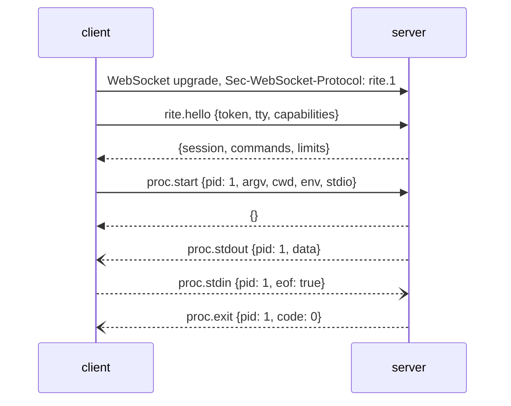

# rite.1 protocol

rite.1 connects a rite client (the browser) to a server that serves a read-only filesystem and commands. It is JSON-RPC 2.0 over WebSocket. rite.1 is a draft until ritesh 1.0; after 1.0 an incompatible change is `rite.2`.

Machine-readable: `protocol/rite.1.schema.json` (JSON Schema 2020-12). Conformance: `protocol/traces/*.jsonl` against the server and client described by `protocol/world.json`.

## Transport

- WebSocket with subprotocol `rite.1`. A server that does not offer it closes the connection.
- Text frames. One JSON-RPC message per frame. No batches.
- Requests carry an `id` (integer, increasing per connection). Notifications carry none.
- Unknown notifications are ignored. Unknown requests answer `-32601`. Unknown fields are ignored.

## Handshake

The first message is the `rite.hello` request. Until it succeeds the server accepts nothing else.

Params: `protocol` (`"rite.1"`), `version` (client version), `token`, optional `session` (to resume), `tty` (`cols`, `rows`), `capabilities` (strings).

Result: `session`, `resumed`, `commands` (descriptors: `name`, `summary`, `usage`, optional `flags`, `subcommands`), `limits` (`maxMessageBytes`, `maxProcs`, `maxOutputBytes`, `idleSeconds`), `capabilities`, optional `motd`.

- The token comes from a host callback, called on every connection attempt. The server never logs it.
- A session id is 128 random bits, bound to the principal that authenticated it, valid for 10 minutes after a disconnect.
- Resuming with another principal's session closes with 4001. A resume closes the previous connection for that session with 4040.
- No process survives a disconnect. Resume restores the session's identity, not its processes.

## Requests

| Method | Params | Result |
|---|---|---|
| `rite.hello` | above | above |
| `fs.stat` | `path` | `type` (`dir` or `file`), `size`, `mode`, `mtime` |
| `fs.list` | `path` | `entries` (`name`, `type`), `truncated` |
| `fs.read` | `path`, optional `offset`, `length` | `data`, `eof` |
| `proc.start` | `pid`, `argv`, `cwd`, `env`, `stdio` (`stdin`, `stdout`, `stderr`: `tty` or `pipe`) | `{}` |
| `proc.complete` | `argv`, `index` | `candidates` (`value`, optional `display`, `description`, `suffix`) |

- Paths are relative to the remote's root: `""` is the root, segments are separated by `/`, and `..` or NUL is `EINVAL`.
- `cwd` is relative to the root, or `""` when the client's cwd is outside the remote.
- `env` holds only the variables the host allows.
- The filesystem is read-only. There are no write methods; a client write to a remote path fails `EROFS` without a request.

## Notifications

| Direction | Method | Params |
|---|---|---|
| client to server | `proc.stdin` | `pid`, and `data` or `eof: true` |
| client to server | `proc.signal` | `pid`, `signal` (`INT` or `KILL`) |
| client to server | `tty.resize` | `cols`, `rows` |
| server to client | `proc.stdout`, `proc.stderr` | `pid`, `data` |
| server to client | `proc.exit` | `pid`, `code` (0 to 255) |
| server to client | `fs.changed` | `path`, `kind` (`create`, `delete`, `modify`) |
| server to client | `term.notify` | `text`, `level` (`info`, `warn`, `error`) |

## Processes

- The client allocates pids: integers, increasing, unique for the connection, never reused. A duplicate pid fails `proc.start` with `EINVAL`. pids are scoped to the connection.
- Every `proc.stdout` and `proc.stderr` for a pid comes before its `proc.exit`. Nothing for that pid follows `proc.exit`.
- `data` is UTF-8 text. The server holds an incomplete code point until its remaining bytes arrive and replaces invalid bytes with U+FFFD.
- `INT` asks the process to stop; the process decides its exit code (130 by convention). `KILL` ends it; the server sends `proc.exit` with 137. The client sends `KILL` when the local reader of a pipeline has exited and on dispose.
- Output from the server is filtered by the client (`sgr` policy). The server cannot send raw terminal control.

## Errors

- Protocol faults use JSON-RPC codes: `-32700` parse, `-32600` invalid request, `-32601` unknown method, `-32602` invalid params.
- Application errors use `-32000` with `data`: `errno` (the set in `src/contracts.ts`) and optional `path`.

## Close codes

| Code | Meaning | Client retries |
|---|---|---|
| 4000 | bad hello | no |
| 4001 | unauthorized | no |
| 4003 | origin not allowed | no |
| 4008 | hello timeout | yes |
| 4029 | rate limited | yes, after backoff |
| 4040 | session replaced | no |
| 4500 | server error | yes |

## Limits

The server enforces, and reports the first four in `rite.hello`:

- `maxMessageBytes`: the largest message either side may send. The client splits stdin under it.
- `maxProcs`: processes running at once per session.
- `maxOutputBytes`: output per process; past it the process is killed and `proc.stderr` says why.
- `idleSeconds`: the server closes an idle connection after it; the client reconnects on next use.
- Not reported: messages per second, sessions per principal, wall time per process, stdin buffer per process, argv, env, and path lengths, `fs.read` and `fs.list` sizes, unauthenticated connections per address (5 s to send `rite.hello`, at most 8 KiB).

## Origin and paths

- The server compares `Origin` to its allowlist by exact scheme, host, and port. A missing or `null` Origin is rejected (4003).
- The server resolves every path against its own root and never follows a link out of it. The client's normalization is not a security boundary.

## Traces

Each line of `protocol/traces/*.jsonl`:

| Field | Meaning |
|---|---|
| `dir` | `c2s` or `s2c` |
| `msg` | the message |
| `match` | `exact`, or `shape`: values of `session` and `data` in strings may differ, keys and types must match |
| `close` | instead of `msg`: the close code expected |

A server replay sends the `c2s` lines in order and checks each `s2c` line. A client replay feeds the `s2c` lines to the client under test and checks what it sends. `protocol/world.json` is the filesystem and commands the test server registers.
