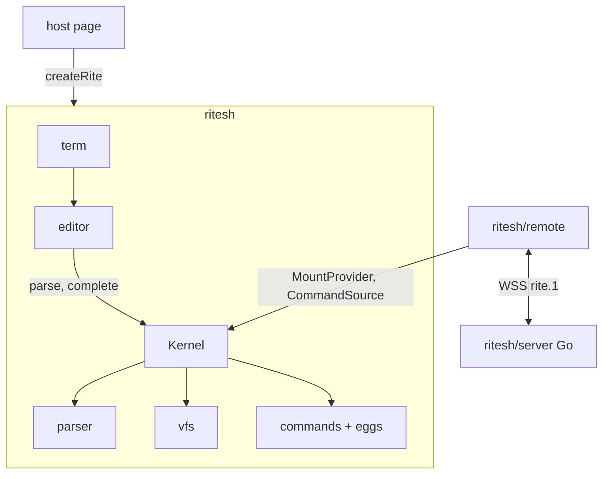

# ritesh design

## Goal

`rite` is a shell for the browser. ritesh is the library that runs it on xterm.js. A host page embeds it, mounts its own directories and commands, and can connect it to one server over WSS. The first host is the mdm developer site (`qbranchio/mdmsdk`). It is an open-source library: publishing, the CDN, and the docs are part of the deliverable.

This rewrites the 2012 ritesh.js in place. No 2012 code carries forward; its ideas do (commands are inodes, directories act, easter eggs).

## Constraints

- xterm.js 6.0.0 and its addons (`fit`, `unicode11`, `web-links`) are the only third-party code, bundled into the output at exact versions. Everything else is rite's.
- rite is not bash, zsh, or POSIX. `docs/language.md` defines the language; the parser follows it.
- The remote protocol is JSON-RPC 2.0. The server decides what runs. The client sends argv, input lines, and signals; it never receives code or raw terminal control.
- Repo `jarrodb/ritesh` (public). Go module `github.com/jarrodb/ritesh/server`. npm `ritesh` (see Decisions).
- MIT, `Copyright (c) 2026 Jarrod Baumann`. The LICENSE covers the new code; the 2012 code keeps its own header under the `legacy` tag.
- Browser baseline: the current and previous major release of Chromium, Firefox, and Safari. Playwright runs all three engines. Mobile renders and accepts input; it gets no mobile-specific editing in v1.

## Architecture



Arrows are call direction. Import rules:

| Module | Owns | Imports |
|---|---|---|
| `contracts` | every cross-module type | nothing |
| `term` | the xterm instance, output filter, resize, theme, width table | xterm, contracts |
| `parser` | lexer with spans, AST, `quoteWord`, `incomplete` detection | contracts |
| `vfs` | inode tree, mount table, path resolution, permissions | contracts |
| `kernel` | session, executor, pipes, redirects, signals, completion, command registry, `p.sys` | parser, vfs, contracts |
| `editor` | the input line | contracts (receives `Term` and kernel facade at construction) |
| `commands`, `eggs` | `/bin` and the easter eggs | contracts |
| `remote` | rite.1 client; exposes a `MountProvider` and a `CommandSource` | contracts |
| `index` | `createRite`, wiring | all above except `remote` |

`remote` is a separate entry (`ritesh/remote`); core never imports it. Only `term` imports xterm.

## Contracts

`src/contracts.ts` is written in phase 0 and frozen for each wave. Agents implementing a wave do not edit it; they report gaps.

Process:

```ts
interface Proc {
  argv: string[]; flags: Flags; args: string[]           // parsed per the command's definition
  stdin: ReadableStream<string>; stdout: WritableStream<string>; stderr: WritableStream<string>
  out(s: string): Promise<void>; err(s: string): Promise<void>; lines(): AsyncIterable<string>
  env: Readonly<Record<string, string>>; cwd: string; fs: Vfs; signal: AbortSignal
  tty: Tty | null                                        // null when stdout is not the terminal
  sys: Sys
}
type Run = (p: Proc) => Promise<number | void>
```

- Chunks are arbitrary. Commands write `\n`; the tty sink converts to `\r\n` and resolves each write from xterm's `write(data, callback)`.
- The kernel closes `stdout` and `stderr` when `run` settles. `void` is exit 0. A throw is exit 1 with one formatted stderr line.
- ^C aborts `p.signal`, errors that pipeline's streams, sets `$?` to 130, and stops waiting for commands that ignore the abort.
- When a reader finishes, upstream stages are aborted with `EPIPE`. Pipeline status is the last stage's.
- Terminal stdin is cooked: the editor collects a line with echo and delivers it. ^D on an empty line closes stdin. `p.tty.read({ echo: false })` reads one line without echo (for `sudo`). No raw mode in v1.
- `Tty`: `cols`, `rows`, `read`, and `raw(s)` (unfiltered output, local commands only: `clear`, egg animations).

Kernel facade:

```ts
interface Sys {
  resolve(name: string): Resolution                     // alias | builtin | command path | egg | not found
  commands(): CommandInfo[]
  spawn(argv: string[], opts?: { uid?: number; env?: Env; stdio?: Stdio }): Promise<number>
  session: Readonly<{ user: string; uid: number; cwd: string; hostname: string }>
}
```

Builtins use the same `Run` plus a mutable session handle and honor redirects and pipelines (in a pipeline, a builtin's state changes do not persist).

Filesystem:

```ts
interface Vfs {
  stat(path, o?): Promise<Stat>; list(path, o?): Promise<Entry[]>; read(path, o?): Promise<string>
  write(path, data, o: { mode: "truncate" | "append" }): Promise<void>; mkdir; remove
  activate(path, via: "cd" | "open" | "cat"): Promise<ActionResult | null>
  peek(path): Inode | undefined                         // cache only, sync, no I/O; the editor uses only this
}
interface MountProvider {
  readonly: boolean
  stat(rel, { signal }): Promise<Stat>; list(rel, { signal }): Promise<Entry[]>; read(rel, { signal }): Promise<string>
  write?; mkdir?; remove?; watch?(onChange: (rel: string) => void): () => void
}
```

Errors are one class, `RiteError { errno, path?, message }`, with one errno set shared with rite.1: `ENOENT ENOTDIR EISDIR EACCES EPERM EEXIST ENOTEMPTY EROFS ELOOP EINVAL ENOTSUP ENOSPC EIO EPIPE ECANCELED ETIMEDOUT ENOTCONN`. One formatter prints `<cmd>: <path>: <message>`; builtins print `rite: <builtin>: ...`.

Completion:

```ts
kernel.complete(line, cursor, { signal }): Promise<{ span: [number, number]; candidates: Candidate[] }>
type Candidate = { value: string; display?: string; description?: string; suffix?: string }
// command hook: complete({ argv, index, prefix, env, cwd, fs, signal }) => Promise<Candidate[]>
```

The editor filters and renders, cancels on the next key, and inserts through `parser.quoteWord`.

Phase 0 ships an in-memory fake for every contract and a harness that runs `echo hi | cat > /tmp/x` through the fakes.

## Language

`docs/language.md` holds the grammar and a machine-readable case table (input, tokens, argv, stdout, exit). v1:

- Quoting: `'...'` has no escapes. Inside `"..."` only `\"`, `\\`, `\$` are escapes and `$VAR`/`${VAR}` expand. Unquoted `\` escapes the next character. Adjacent parts form one word (`a'b'"c"`). `#` starts a comment only at the start of a word.
- Operators: lists `;` `&&` `||` (left-associative, equal precedence); pipelines `|` bind tighter.
- Redirects: `>`, `>>`, `<`, `2>`, `2>>`, `2>&1`, `>&2`. Processed left to right, so `> f 2>&1` and `2>&1 > f` differ as in POSIX. Allowed anywhere in a simple command. Targets are opened and truncated before the command starts. A redirect with no command, a target that expands to several words (`ambiguous redirect`), or a directory (`EISDIR`) is an error. Builtins honor redirects.
- Expansion order: alias (command position, no recursion into the same alias), tilde (unquoted, word start), parameter, glob, quote removal. No field splitting: `$VAR` is always one word. Glob characters count only when unquoted in the source, never from an expansion. An undefined variable is empty.
- Globs: `*` and `[...]`; `*` skips dotfiles; results sorted by code point. No match is an error (exit 1, command not run). `?` is a literal in v1. `**` is reserved. No globbing in assignments.
- Variables: `NAME=value` sets a shell variable; `NAME=value cmd` scopes it; `export`, `unset`. Kernel-owned, read-only: `UID`, `RITE_VERSION`, `SHELL=/bin/rite`. `USER`, `HOME`, `PWD`, `OLDPWD`, `HOSTNAME`, `PATH=/bin:/usr/bin` are set by the kernel and writable; changing `USER` does not change uid. `$?` is the last status.
- Aliases from `~/.riterc` or `alias`; an alias may contain operators.
- Reserved, a syntax error (exit 2, `rite: '<token>' is not supported in rite <version>`) when unquoted: `` ` ``, `$(`, `$((`, `$'`, `$"`, `(`, `)`, `{`, `}`, `<<`, `<<<`, `<(`, `>(`, `|&`, `&>`, `>|`, `;;`, `&`, `[[`, `((`, `$0`-`$9`, `$@ $* $# $$ $!`, `~user`, `${` with anything but a name, and in command position `!` and `if then else elif fi for in do done while until case esac function return break continue local`. The `&` error suggests quoting (URLs with query strings). Unquoted JSON arguments are an error by consequence; quote them.
- `incomplete`: the parser reports an open quote or a trailing operator, and the editor continues the line.
- Exit codes: 0, 1 (general), 2 (usage and syntax), 126 (`EACCES` or not executable), 127 (not found), 130 (interrupt), 255 (remote connection lost). Values clamp to 0-255.

## Filesystem

Inode types: `dir`, `file` (string, or function returning string or Promise), `cmd`, `link`, `action`, `dev` (read and write handlers; `/dev/null`). Mounts are mount-table entries, not inodes.

- Paths: the vfs takes absolute or cwd-relative paths; `~` is kernel expansion. `..` is lexical. Links resolve to depth 16, then `ELOOP`; a dangling link stats as `ENOENT`.
- Permissions are presentation, not security. Users: the host's user (uid 1000) and root (uid 0). Owner bits only; gid is display-only. Root bypasses checks. Directories need `x` to enter. New files `0644`, dirs `0755`.
- Memory only, per page load. `.riterc` edits do not persist. Caps: 1 MiB per file, 8 MiB total, then `ENOSPC`.
- Actions: `stat` and `list` never trigger them. Only `cd`, `open`, and `cat` call `vfs.activate`. Definition is one of `{ navigate: href }`, `{ open: url }`, `{ event: name, detail }`, `{ print: text }`. The host receives `{ kind, href?, url?, name?, detail?, path, via }` through `onAction` and can `preventDefault()`. URLs are `http:` or `https:` only. If `window.open` returns null, `open` prints the URL.
- Default tree: `/bin`, `/usr/share/man`, `/etc/motd`, `/etc/hostname`, `/home/<user>/.riterc`, `/root`, `/tmp`, `/dev/null`.

## Commands

```ts
defineCommand({
  name: "head", summary: "output the first lines", usage: "head [-n lines] [file...]",
  flags: { n: { long: "lines", type: "number", default: 10 } },
  subcommands: { /* same shape, for command sets like mdm */ },
  complete, run,
})
```

- Flags: boolean, string, number; short and long; combined shorts; `--` ends flags. Omitting `flags` passes raw argv. `--help` and usage errors (exit 2) come from the definition.
- Builtins: `cd`, `export`, `unset`, `alias`, `unalias`, `exit`, `history`, `source`, `rite`.
- `/bin` v1: `ls`, `cat`, `echo`, `pwd`, `env`, `which`, `type`, `clear`, `help`, `man`, `sudo`, `whoami`, `id`, `uname`, `hostname`, `date`, `true`, `false`, `grep`, `head`, `tail`, `wc`, `sort`, `uniq`, `tee`, `mkdir`, `touch`, `rm`, `open`.
- `man <cmd>` renders the definition, or a page under `/usr/share/man`.
- `rite --version`, `rite -c '<line>'`.
- `sudo`: the host sets `sudo: false | true | (password) => boolean`. `false` is the default and triggers the `sudoers` egg.

## Line editor

- Keys: ^A ^E ^B ^F ^K ^U ^W ^Y ^L ^C ^D ^R, Alt-B/F/D, Alt-Backspace, Ctrl-Backspace, arrows, Home/End, Delete. `macOptionIsMeta` on. Browsers that reserve ^W (closing the tab) are documented, with Alt-Backspace as the alternative.
- Cursor unit: grapheme clusters (`Intl.Segmenter`). Width from the unicode11 provider, which `term` registers and exposes as `term.width(codePoint)`.
- History: `history: "local" | "memory" | false` (default `"local"`). Key `rite:<hostname>:<user>:history`. A leading space skips recording. Lines read by `p.tty.read` are never recorded. Caps: 1000 entries, 256 KiB. Merges on the `storage` event. Storage access wrapped in try/catch.
- Tab completes; a second Tab opens a menu. Autosuggestion from history, shown dim, accepted with Right. Highlighting uses parser tokens and `vfs.peek` only.
- Prompt: `PROMPT` in `.riterc` compiles to `PromptSegment[]`. Escapes: `%n` user, `%m` host, `%~` cwd, `%#` (`#` for uid 0, else `%`), `%?` last status, `%F{color}...%f`.
- Accessibility: `screenReaderMode` option passed to xterm. Escape then Tab moves focus out of the terminal; the page states it.
- Input sequences that are not keys (terminal replies) are discarded.

## Output safety

`term` applies one filter per source:

| Policy | Allows | Used for |
|---|---|---|
| `plain` | printable text, `\n`, `\t` | motd, notify, summaries, prompt text, remote file names |
| `sgr` | `plain` plus `CSI ... m` | every process stdout/stderr, local or remote |
| `raw` | everything | `p.tty.raw`, local commands only |

xterm's `linkHandler` and the web-links addon open `http:` and `https:` URLs only.

## Easter eggs

```ts
defineEgg({ id: "sudoers", trigger: { command: "sudo" }, run: async (p) => PASS | number })
```

- Triggers: `command` (name, or name plus argv predicate), `input` (regex on the raw line, checked before parsing), `keys` (sequence, attached by the editor through the kernel's egg registry).
- Order: `input` eggs, then alias and expansion, then `command` eggs, then lookup. The first egg that does not return `PASS` handles the line. In a pipeline, `command` eggs apply to each stage.
- `createRite({ eggs })` registers; `eggs: false` disables all.
- Shipped in `ritesh/eggs`:
  - `sudoers`: `<user> is not in the sudoers file. This incident will be reported.`
  - `rmrf`: matches `rm` with recursive and force flags (any spelling) and a target that normalizes to `/`. Prints a fake deletion cascade, then `just kidding. nothing here is yours to delete.`
- Product eggs live in the host (mdm: `memdsk`).

## Remote protocol (rite.1)

Defined in `docs/protocol.md` and `protocol/rite.1.schema.json` (JSON Schema 2020-12). rite.1 is a draft until ritesh 1.0; after that, an incompatible change is `rite.2`.

Transport:

- WebSocket subprotocol `rite.1` (`Sec-WebSocket-Protocol`). Text frames, one JSON-RPC message per frame, no batches.
- Unknown notifications are ignored, unknown requests answer `-32601`, unknown fields are ignored. Both sides send `capabilities: string[]` in the handshake.
- Close codes: 4000 bad hello, 4001 unauthorized, 4003 origin, 4008 hello timeout, 4029 rate limited, 4040 session replaced, 4500 server error. The client does not retry 4001 or 4003.

Messages:

| Kind | Method | Shape |
|---|---|---|
| request | `rite.hello` | `{protocol, version, token, session?, tty:{cols,rows}, capabilities}` → `{session, resumed, commands:[{name, summary, usage, flags?, subcommands?}], limits:{maxMessageBytes, maxProcs, maxOutputBytes, idleSeconds}, capabilities, motd?}` |
| request | `fs.stat` | `{path}` → `{type:"dir"\|"file", size, mode, mtime}` |
| request | `fs.list` | `{path}` → `{entries:[{name, type}], truncated}` |
| request | `fs.read` | `{path, offset?, length?}` → `{data, eof}` |
| request | `proc.start` | `{pid, argv, cwd, env, stdio:{stdin, stdout, stderr: "tty"\|"pipe"}}` → `{}` |
| request | `proc.complete` | `{argv, index}` → `{candidates}` |
| notification c→s | `proc.stdin` | `{pid, data}` or `{pid, eof:true}` |
| notification c→s | `proc.signal` | `{pid, signal:"INT"\|"KILL"}` |
| notification c→s | `tty.resize` | `{cols, rows}` |
| notification s→c | `proc.stdout`, `proc.stderr` | `{pid, data}` |
| notification s→c | `proc.exit` | `{pid, code}` |
| notification s→c | `fs.changed` | `{path, kind:"create"\|"delete"\|"modify"}` |
| notification s→c | `term.notify` | `{text, level:"info"\|"warn"\|"error"}` |

- Remote mounts are read-only in rite.1. Writes answer `EROFS`. Remote inode types are `dir` and `file`.
- pids are allocated by the client, increasing, unique per connection, never reused. The server rejects a duplicate and scopes pids to the connection.
- All output for a pid precedes its `proc.exit`; nothing follows it. `data` is UTF-8 text; the server holds partial code points across chunks and replaces invalid bytes with U+FFFD.
- Errors: JSON-RPC codes for protocol faults; application code `-32000` with `data:{errno, path?}`.
- `--help` and `man` for remote commands render from the descriptor in `rite.hello`.
- `fs.changed` drops the client's cache for that path and its parent listing. The cache holds `stat` and `list` results for 30 s.
- `term.notify` prints above the prompt and redraws the input line; while a job writes to the terminal it is queued until the job exits. The client caps it at 5 per 10 s.

Session and security:

- The token comes from a host callback, called on every connection attempt, and travels in `rite.hello`. The server never logs it.
- Sessions are 128-bit random, bound to the principal `Authenticate` returns, with a 10-minute TTL after disconnect. A resume from another principal fails with 4001. A resume closes the previous connection (4040).
- No process survives a disconnect. The client ends pending pids with exit 255 and `rite: connection lost`.
- Before `rite.hello` succeeds the server accepts only `rite.hello`, a message of at most 8 KiB, within 5 s, and caps unauthenticated connections per address.
- Origin: exact scheme, host, and port match; a missing or `null` Origin is rejected.
- The server canonicalizes every path against its mount root (`os.Root` for disk-backed mounts), rejects `..` and NUL, and never trusts client uid. `cwd` is sent relative to the remote's root, or as the root when outside it.
- Limits the server enforces: message size, messages per second, sessions per principal, processes per session, output bytes and wall time per process, stdin buffer per process, argv/env/path lengths, `fs.read` and `fs.list` sizes. A per-pid output queue that overflows kills that process with a stated error. Cloudflare limits the upgrade request; message metering is the server's job.
- The client chunks stdin under `maxMessageBytes` and waits on `bufferedAmount`. The server sends pings below the proxy idle timeout.
- Reconnect: exponential backoff with jitter, 1 s to 30 s; in-flight requests fail `ENOTCONN` and are not replayed.

Host side:

- v1 takes one remote: `remote({ url, at: "/sandbox", bin: "/sandbox/bin", env: [], token, connect: "lazy", commands: ["mdm"] })`.
- `at` is the mount root, chosen by the host; server paths are relative to it. Remote commands land in `bin` and never replace an existing name.
- `env` is the allowlist of variable names sent with `proc.start`, default empty, and applies to scoped assignments.
- `connect: "lazy"` (default) connects on first use of the mount or a declared command, and disconnects after `idleSeconds`. `commands` declares names up front so completion and `which` work before connecting.

`ritesh/server` (Go, `github.com/coder/websocket` v1.8):

```go
srv := server.New(server.Options{
    Authenticate: func(ctx context.Context, token string) (server.Principal, error) { ... },
    Origins:      []string{"https://example.dev"},
    Limits:       server.DefaultLimits,
})
srv.Mount("/", fsys)                                   // fs.FS, read-only
srv.Command(server.Command{Name: "mdm", Summary: "...", Run: func(ctx context.Context, p *server.Proc) int { ... }})
    // p.Args, p.Stdin, p.Stdout, p.Stderr, p.Env, p.Cwd, p.TTY (cols, rows, stdio kinds), p.Principal
srv.OnSession(func(s server.Session) { s.Notify("info", "device enrolled") })
http.Handle("/rite", srv)
```

One writer goroutine per connection. Sessions live in process memory: run one replica, or pin by session at the proxy.

## Host API

```ts
import { createRite } from "ritesh"
import { sudoers, rmrf } from "ritesh/eggs"
import { remote } from "ritesh/remote"
// <link rel="stylesheet" href=".../rite.css"> (contains xterm's CSS)

const rite = createRite({
  element: document.querySelector("#term"),
  hostname: "enroll", user: "guest", motd: "welcome. type help.",
  files: { "/home/guest/about.txt": "..." },
  mounts: [{ path: "/tenants", provider: mockProvider }],
  commands: [mdm], eggs: [sudoers, rmrf, memdsk],
  remote: remote({ url: "wss://sandbox.example/rite", at: "/sandbox", token: getToken }),
  sudo: false, history: "local", theme: {}, screenReaderMode: false,
  onAction: (e) => router.push(e.href),
})
await rite.ready
await rite.exec("ls /bin")     // queued behind any running job; resolves { code }
rite.print("text")            // host output above the prompt (plain policy)
rite.focus(); rite.fit()
rite.dispose()                 // aborts jobs, closes the socket, releases xterm; safe to call twice
```

`exit` at the top level ends the session, prints `[session ended]`, and offers Enter to restart.

## Packaging and publishing

- ESM only: `"type": "module"`, `files: ["dist"]`, `exports` for `.`, `./eggs`, `./remote`, `./rite.css`, `./package.json`, with `types` first in each condition. `sideEffects: ["*.css"]`. `unpkg` and `jsdelivr` fields point at the IIFE bundle.
- Build: `tsdown` 0.23.7, pinned exactly; CI Node 24. xterm 6.0.0 and the three addons are exact devDependencies, bundled (`deps.alwaysBundle`); no peer dependency.
- Outputs: ESM entries with `.d.ts`; `dist/rite.bundle.min.js` (IIFE, global `Rite` = `{ createRite, defineCommand, defineEgg, eggs, remote }`); `dist/rite.css`, a static file with xterm's CSS and rite's, copied at build, never imported from JS.
- Licence notices: a banner in every output and `THIRD_PARTY_NOTICES` in the tarball for xterm.
- CSP: `docs/embedding.md` lists `style-src 'unsafe-inline'` (xterm creates style elements at runtime), `connect-src` for the WSS host, and `script-src` with SRI.
- Size budgets (gzip): `rite.bundle.min.js` 150 kB; rite's own code excluding xterm 45 kB. xterm and the addons measure about 102 kB.
- `protocol/` is the source of truth; the build copies the schema into `server/` (for `go:embed`) and into the package, with a drift check in CI. TS protocol types are generated from the schema; Go types are hand-written and tested against the fixtures.
- CDN: jsDelivr, unpkg, and esm.sh serve every npm version with no setup. The release workflow hashes `rite.bundle.min.js` and `rite.css` from the packed tarball, fetches the exact-version jsDelivr and unpkg URLs after publish, and fails if the bytes differ. SRI hashes go in the release notes, README, and docs. esm.sh rebuilds its output, so it is listed without SRI. cdnjs submission after 1.0.

Release flow:

1. The owner runs `changeset version`, commits, and pushes a signed tag `vX.Y.Z`.
2. The workflow verifies the tag signature against the owner's key, then runs every gate.
3. npm publish through trusted publishing (OIDC, `id-token: write`, a protected `release` environment, provenance on, no token fallback).
4. The workflow creates `server/vX.Y.Z` on the same commit. npm and Go versions move in lockstep. A bad Go tag is handled with `retract`.
5. CDN verification and the GitHub release with SRI hashes.

The npm package name is claimed in phase 0 (a `0.0.0` placeholder published by hand) so trusted publishing can be configured on it.

## Repo layout

```
packages/ritesh/     src/{contracts.ts,term,editor,parser,kernel,vfs,commands,eggs,remote,index.ts}
server/               Go module (go.mod, LICENSE copy, embedded schema)
protocol/             rite.1.schema.json, traces/*.jsonl, world.json (the test server's mounts and commands)
docs/                 language.md, protocol.md, embedding.md, commands.md, specs/
site/                 demo and docs host (GitHub Pages); man pages render inside rite
.github/              workflows, issue and PR templates
```

pnpm workspace at the root. The 2012 code is tagged `legacy` and removed from the tree.

## Open source

`README.md` (what, install, CDN snippet with SRI, a 20-line embed, link to the demo), `LICENSE`, `THIRD_PARTY_NOTICES`, `CONTRIBUTING.md`, `CODE_OF_CONDUCT.md` (Contributor Covenant, latest version at phase 0), `SECURITY.md` (GitHub private vulnerability reporting), `CHANGELOG.md` (Changesets), `AGENTS.md`, issue and PR templates.

## Testing

- Parser: the `language.md` case table.
- vfs, kernel: lines in, stdout/stderr/exit out, through stream sinks; no xterm.
- Editor: key sequences in, rendered line and cursor out, against the `term` interface backed by `@xterm/headless` (imported from `lib-headless/xterm-headless.mjs`; the package's `module` field points at a missing file).
- Commands: every `--help`, usage error, and exit code.
- Protocol: traces (`direction, message, match`) replayed against the TS client and against the Go server; plus a CI job that runs the Go test server and drives the TS client against it, covering ordering, reconnect, limits, malicious frames, and session isolation.
- Package: pack the tarball, install it in a temp project, `node -e "await import('ritesh')"`, import every export, check the IIFE global in a page. publint and attw (ESM-only profile). size-limit.
- Browser: Playwright on Chromium, Firefox, WebKit with the ESM build and the IIFE bundle: typing, completion, ^C, resize, axe.

## Decisions

- Own interpreter. just-bash (Vercel Labs) rejected: rite is its own shell, and no library is the de facto standard for this.
- Own line editor. xterm-readline rejected: completion menu, autosuggestion, and highlighting need parser spans.
- Own JSON-RPC client and server framing; the standard is the protocol. Go server uses `coder/websocket` for the transport.
- No PTY passthrough.
- Rewrite in `jarrodb/ritesh`; 2012 code under the `legacy` tag.
- MIT, Copyright (c) 2026 Jarrod Baumann.
- One npm package with subpath exports.

<<<<<<< review
xterm as a peer dependency, two IIFE builds (with and without xterm), `@xterm/xterm` ^6 so a page with xterm loads it once.
||| codex gap: the external IIFE defines no xterm global or addon wiring; peer and addon ranges unspecified.
||| fable reject: verified on Node 24, `import { Terminal } from "@xterm/xterm"` throws (UMD main, no exports map), so any SSR or SSG host fails at import; addons declare no peer, so npm cannot pair versions; the Host API never exposes Terminal.
||| claude accept: bundling removes the failure and the version-pairing problem; the cost is a second xterm on pages that already have one, which no planned host has.
=======
xterm 6.0.0 and addons bundled at exact versions, no peer. One IIFE bundle.
>>>>>>> claude+codex

<<<<<<< review
rite/1 with client→server and server→client methods listed in one table; `term.write` and `prompt.set` for server push; session resume by id; multiple remotes.
||| codex gap: no request/notification split, error codes, EOF, ordering, encoding, fs shapes; session id is a bearer credential; output and notify can inject terminal control; client PIDs may collide.
||| fable gap: same, plus pre-auth window, server-chosen paths can shadow /bin, no flow control, versioning only by name. Recommends client pids scoped per connection rather than server handles.
||| claude accept-partial: adopted the wire contract, session binding, output policies, host-chosen roots, limits, subprotocol versioning; cut term.write, prompt.set, process resume, multiple remotes, writable remote mounts. Kept client-allocated pids (fable): pids are scoped to one connection and validated, so cross-session signaling cannot happen.
=======
rite.1 as specified above.
>>>>>>> claude+codex

<<<<<<< review
Language summarized in eight bullets; details deferred to language.md.
||| codex gap: precedence, expansion order, splitting, glob behavior, redirect order, $? timing, reserved token behavior undefined.
||| fable gap: same, with concrete picks (no field splitting, no-match is an error, ? literal, reserved syntax errors, left-to-right redirects).
||| claude accept: decisions taken now because they are expensive to change after 0.x.
=======
Language rules as specified above; language.md adds the grammar and case table.
>>>>>>> claude+codex

<<<<<<< review
Changesets plus a signed-tag trigger; build and size gates in phase 4.
||| codex gap: a signed-tag trigger does not verify the signature; Changesets does not version the Go module; SRI must come from the published bytes.
||| fable reject: Changesets creates unsigned tags in CI; gates must exist from phase 0 because bundling and CSS shape the tree.
||| claude accept: owner-signed tag, verified in CI, lockstep Go tag after gates; build gates move to phase 0.
=======
Release flow and gates as specified above.
>>>>>>> claude+codex

<<<<<<< review
npm package `rite.sh`.
||| fable question: npm blocks new names that differ from an existing one only by punctuation.
||| claude edit: confirmed. `ritesh` exists on npm (another owner, created 2017, last published 2022, no README, about 23 downloads a month), so `rite.sh` and `rite-sh` are refused.
||| owner edit: the name is `ritesh`, everywhere.
=======
npm name `ritesh`. Phase 0 asks the current owner for a transfer and, if there is no answer, files an npm support request under the name-squatting policy. Until `ritesh` is ours, prereleases publish as `@jarrodb/ritesh`; imports, CDN URLs, and docs switch to `ritesh` when the transfer lands.
>>>>>>> claude

- Cut from v1: `su`, interactive subshell, the `path` egg trigger, gid checks, `rite.min.js`.

## Phase plan

Each phase: implement, lint and test, Codex review, commit. Units marked (F) go to Fable 5.2 sub-agents; agent choice is confirmed with the owner before dispatch. A unit owns its directory and does not edit `contracts.ts`, `language.md`, or `protocol/`.

0. Foundation (inline): `legacy` tag; layout, pnpm, tooling; LICENSE and community files; `contracts.ts` with fakes; `language.md` with the case table; `protocol.md`, schema, traces, `world.json`, replay harness; `term` interface with a headless implementation; every build output from a stub entry with publint, attw, size-limit, and the pack-and-import test in CI; npm name claimed. Exit test: `echo hi | cat > /tmp/x` runs through the fakes.
1. Wave A, in parallel: parser (F, typescript); vfs (F, typescript); rite.1 client (F, typescript); Go server (F, golang). Each against the phase 0 fakes, traces, and case table.
2. Kernel (inline), after wave A: executor, pipes, redirects, signals, completion, builtins, `p.sys`. Replaces the kernel fake.
3. Wave B, in parallel: editor (F, typescript); `/bin` commands and `man` (F, typescript); eggs (F, typescript). `term` xterm implementation and `createRite` (inline). `commands.md`.
4. Integration: client-to-server CI job, Playwright on three engines, `embedding.md`, demo site on GitHub Pages.
5. Release: release workflow, CDN verification, `0.1.0`. Publishing asks first.
