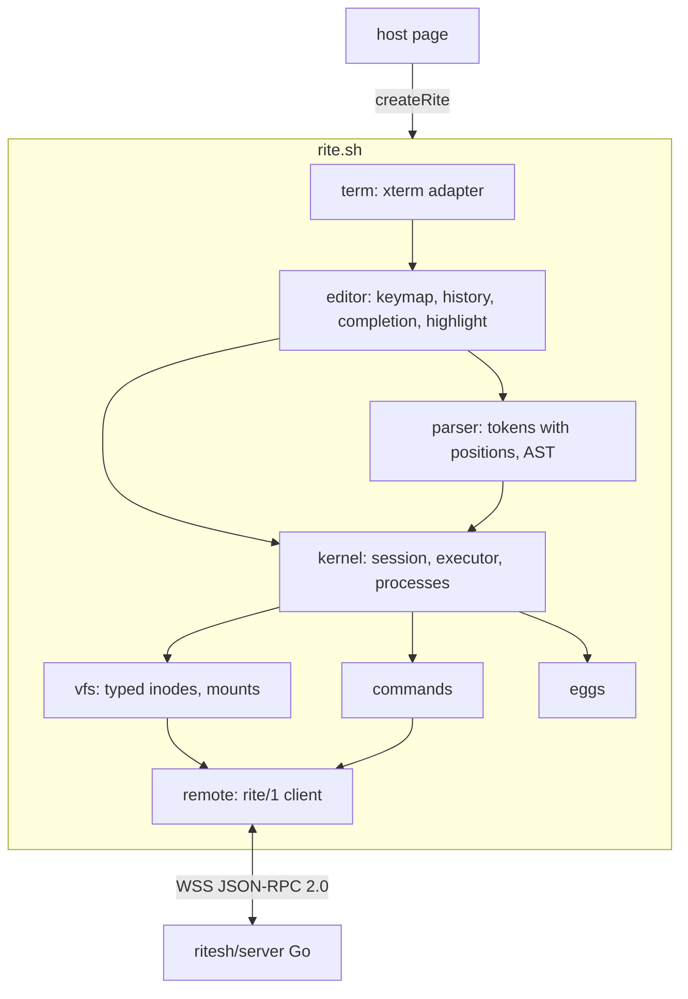

# rite.sh design

## Goal

`rite` is a shell for the browser. rite.sh is the library that runs it on xterm.js. A host page embeds it, mounts its own directories and commands, and can connect it to a server over WSS. The first host is the mdm developer site (`qbranchio/mdmsdk`). It is an open-source library: publishing, the CDN, and the docs are part of the deliverable, not follow-up.

This rewrites the 2012 ritesh.js in place. Nothing from the old code carries forward; its ideas do (commands are inodes, directories act, easter eggs).

## Constraints

- One runtime dependency: `@xterm/xterm` 6 (peer), plus xterm's own addons (`fit`, `unicode11`, `web-links`). Everything else is rite's.
- rite is not bash, zsh, or POSIX. Its language is defined by `docs/language.md`, and the parser follows that document.
- The remote protocol is JSON-RPC 2.0. The server decides what runs; the client sends argv and keystrokes, never receives code.
- MIT, `Copyright (c) 2026 Q Branch`.
- Repo: `jarrodb/ritesh`. npm: `rite.sh`. Go: `github.com/jarrodb/ritesh/server`.

## Architecture



| Module | Owns | Depends on |
|---|---|---|
| `term` | the xterm instance, resize, theme, bracketed paste. The only module that imports xterm. | xterm |
| `editor` | the input line: keymap, history, ^R search, completion menu, autosuggestion, highlighting | parser (tokens), kernel (completion sources) |
| `parser` | lexer with source spans, AST | nothing |
| `kernel` | session (user, uid, cwd, env, `$?`, history, aliases), AST execution, pipes, redirects, signals | parser, vfs, commands |
| `vfs` | inode tree, path resolution, permissions, mount table | nothing |
| `commands` | built-ins and `/bin` | kernel contracts only |
| `eggs` | easter egg registry and triggers | kernel contracts only |
| `remote` | rite/1 client, remote mounts, remote commands, server push | vfs and kernel contracts |

Modules talk through the types in `src/contracts.ts` (phase 0). A command never touches kernel internals.

## Language

Full grammar in `docs/language.md` (phase 0). v1 covers:

- Words; `'literal'`; `"expanding $VAR ${VAR}"`; `\` escapes; `#` comments.
- Lists `;`, `&&`, `||`. Pipelines `|`. Redirects `>`, `>>`, `<`, `2>`, `2>&1` into the vfs.
- `NAME=value` (shell variable), `NAME=value cmd` (scoped), `export`, `unset`.
- Expansion: `$VAR`, `${VAR}`, `$?`, `~`, globs `*` `?` `[...]` against the vfs.
- Aliases, from `~/.riterc` or `alias`.
- Reserved for later versions: `$(...)`, `if`, `for`, functions, `&` jobs. The lexer reserves their tokens so adding them does not change existing meaning.

Variables set by the kernel: `USER`, `HOME`, `PWD`, `OLDPWD`, `SHELL=/bin/rite`, `HOSTNAME`, `PATH=/bin:/usr/bin`, `RITE_VERSION`.

## Filesystem

Inode types:

| Type | Behavior |
|---|---|
| `dir` | children; `cd`, `ls` |
| `file` | content: string, or a function returning string or Promise of string |
| `cmd` | a command; found through `PATH` |
| `link` | path to another inode |
| `action` | does something on `cd`, `open`, or `cat`: navigate, open a URL, emit a host event, print |
| `mount` | a subtree served by a provider (host object or remote server) |

Each inode has `mode`, `uid`, `gid`, `mtime`, so root, `sudo`, and permission errors are real. Paths are normalized (`.`, `..`, `//`, `~`) in one function. Errors use errno names (`ENOENT`, `ENOTDIR`, `EACCES`, `ENOTCONN`) and print as `rite: cd: /x: no such file or directory`.

Default tree: `/bin`, `/etc` (`motd`, `hostname`), `/home/<user>` with `.riterc`, `/root`, `/tmp`, `/dev/null`. The host adds the rest.

## Commands

```ts
defineCommand({
  name: "ls",
  summary: "list directory contents",
  usage: "ls [-la] [path...]",
  flags: { l: "long", a: "all" },
  complete: ctx => ctx.paths(),
  run: async (p) => { /* p.argv, p.flags, p.stdin, p.stdout, p.stderr, p.env, p.cwd, p.fs, p.signal, p.tty */ return 0 },
})
```

- `stdin`/`stdout`/`stderr` are web streams of strings. Pipes and redirects work for every command without command code.
- `p.signal` is an `AbortSignal`; ^C aborts it. Exit code 130 on abort.
- Flag parsing, `--help`, and usage errors (exit 2) come from the definition.
- Built-ins (run in the kernel): `cd`, `export`, `unset`, `alias`, `unalias`, `exit`, `history`, `rite`, `source`.
- `/bin` v1: `ls`, `cat`, `echo`, `pwd`, `env`, `which`, `type`, `clear`, `help`, `man`, `sudo`, `su`, `whoami`, `id`, `uname`, `hostname`, `date`, `true`, `false`, `grep`, `head`, `tail`, `wc`, `sort`, `uniq`, `tee`, `mkdir`, `touch`, `rm`, `open`.
- `man <cmd>` renders the command's definition; hosts can add pages under `/usr/share/man`.
- `rite` itself: `rite --version`, `rite -c '<line>'`, `rite` (subshell with its own env and exit).

## Line editor

- Keys: ^A ^E ^B ^F ^K ^U ^W ^Y ^L ^C ^D ^R, Alt-B/F/D, arrows, Home/End, Delete.
- History: per host key, kept in `localStorage` behind try/catch; works without storage.
- Tab: completes commands, paths, and command-defined values; a second Tab shows a menu.
- Autosuggestion: the newest history entry with the typed prefix, shown dim; Right accepts.
- Highlighting from parser tokens: known command, unknown command, string, variable, operator, path that exists.
- Width: xterm `unicode11` addon for wide characters; the editor computes cursor columns with the same table.
- Prompt: `%n@%m %~ %#` style escapes, set by `PROMPT` in `.riterc`; `#` for uid 0.

## Easter eggs

```ts
defineEgg({ id: "sudoers", trigger: { command: "sudo" }, when: s => s.uid !== 0 && !s.host.sudo, run })
```

- Triggers: `command` (name or argv pattern), `path` (on `cd`/`cat`), `input` (regex on the raw line), `keys` (a key sequence).
- Eggs run before command lookup and can pass (fall through) or handle.
- Hosts register eggs and can disable all of them with `eggs: false`.
- Shipped in `rite.sh/eggs`, two to start:
  - `sudoers`: `sudo` without host-configured sudo prints `<user> is not in the sudoers file. This incident will be reported.`
  - `rm -rf /`: prints a fast fake deletion cascade, then `just kidding. nothing here is yours to delete.`
- Personal or product eggs live in the host (mdm: `memdsk`).

## Remote protocol (rite/1)

JSON-RPC 2.0 over WSS. Schema and fixtures in `protocol/`.

| Direction | Method | Params / result |
|---|---|---|
| c→s | `rite.hello` | `{protocol:"rite/1", version, token, session?, tty:{cols,rows}}` → `{session, mounts:[{path,readonly}], commands:[{name,path,summary,usage}], motd?, prompt?}` |
| c→s | `fs.stat` `fs.list` `fs.read` `fs.write` | path-based; `fs.write` only on writable mounts |
| c→s | `proc.start` | `{pid, argv, cwd, env}`; `env` is the host's allowlist only |
| c→s | `proc.stdin` / `proc.signal` | `{pid, data}` / `{pid, signal:"INT"}` |
| c→s | `tty.resize` | `{cols, rows}` |
| s→c | `proc.stdout` / `proc.stderr` / `proc.exit` | `{pid, data}` / `{pid, code}` |
| s→c | `fs.changed` | `{path}`; client drops its cache for that path |
| s→c | `term.notify` | `{text, level}`; printed above the prompt, input line redrawn |
| s→c | `term.write` | `{data}` |
| s→c | `prompt.set` | `{segments}` |

- The token comes from a host callback and travels in `rite.hello` (browsers cannot set WebSocket headers).
- Reconnect with backoff; `session` resumes. While disconnected, mount operations fail with `ENOTCONN`.
- Remote processes join pipelines like local ones.
- Limits enforced by the server package: frame size, processes per session, idle timeout, Origin allowlist.

`ritesh/server` (Go, `github.com/coder/websocket`):

```go
srv := server.New(server.Options{Authenticate: auth, Origins: []string{"https://example.dev"}})
srv.Mount("/sandbox", fsys)                        // fs.FS, or server.WritableFS
srv.Command("mdm", func(ctx context.Context, p *server.Proc) int { ... })  // p.Args, p.Stdin, p.Stdout, p.Stderr, p.Env, p.Cwd
srv.Notify(sessionID, "device enrolled")
http.Handle("/rite", srv)
```

## Host API

```ts
import { createRite } from "rite.sh"
import { sudoers, rmrf } from "rite.sh/eggs"
import "rite.sh/rite.css"

const rite = createRite({
  element: document.querySelector("#term"),
  hostname: "enroll", user: "guest",
  motd: "welcome. type help.",
  fs: { "/home/guest/about.txt": "..." },
  commands: [mdm],
  eggs: [sudoers, rmrf, memdsk],
  remotes: [{ url: "wss://sandbox.example/rite", token: () => getToken() }],
  onAction: (e) => router.push(e.href),
})
rite.exec("ls /bin")      // scripted input for tours and tests
rite.dispose()
```

CDN use (no bundler):

```html
<script src="https://cdn.jsdelivr.net/npm/rite.sh@0.1.0/dist/rite.bundle.min.js" integrity="sha384-..." crossorigin="anonymous"></script>
<script>Rite.createRite({ element: document.getElementById("term") })</script>
```

## Repo layout

```
packages/rite.sh/     src/{contracts.ts,term,editor,parser,kernel,vfs,commands,eggs,remote}
server/               Go module (tags server/vX.Y.Z)
protocol/             rite-1.schema.json, fixtures/*.json
docs/                 language.md, protocol.md, embedding.md, commands.md, specs/
site/                 demo and docs host (GitHub Pages); man pages render inside rite
.github/              workflows, issue and PR templates
```

The 2012 code is tagged `legacy` before the rewrite and removed from the tree.

## Packaging and publishing

- Build: `tsdown`. Outputs:
  - ESM + `.d.ts`, `exports` for `.`, `./remote`, `./eggs`, `./rite.css`; `sideEffects: ["*.css"]`.
  - `dist/rite.min.js`: IIFE, global `Rite`, expects global xterm.
  - `dist/rite.bundle.min.js`: IIFE with xterm inside.
- CDN: jsDelivr, unpkg, and esm.sh serve every npm version with no setup. Each GitHub release lists the CDN URLs with SRI `sha384` hashes, computed in the release workflow. cdnjs submission after 1.0.
- Versioning: Changesets. 0.x until `docs/language.md` and rite/1 are frozen; the protocol version (`rite/1`) is independent of the package version.
- Release: GitHub Actions on a signed tag; npm trusted publishing (OIDC) with provenance; Go module by tag `server/vX.Y.Z`.
- Gates in CI: eslint, `tsc --noEmit`, vitest, Playwright, `publint`, `@arethetypeswrong/cli`, `size-limit` (budget per output), `golangci-lint`, `go test -race`, protocol fixtures against client and server. Renovate per policy (no automerge; patch grouped weekly).

## Open source

`README.md` (what, install, CDN snippet, 20-line embed example, link to demo), `LICENSE` (MIT, Q Branch 2026), `CONTRIBUTING.md`, `CODE_OF_CONDUCT.md` (Contributor Covenant 2.1), `SECURITY.md` (GitHub private vulnerability reporting), `CHANGELOG.md` (Changesets), `AGENTS.md`, issue and PR templates.

## Testing

- Unit: parser (table tests over `docs/language.md` examples), vfs, editor (key sequences in, line and cursor out), kernel (lines in, stdout/stderr/exit out) against `@xterm/headless`.
- Contract: every command's `--help`, usage error, and exit codes.
- Protocol: shared fixtures replayed against the TS client and the Go server.
- Browser: Playwright loads the ESM build and both IIFE builds from a static page; typing, completion, ^C, resize, axe.
- Size: `size-limit` fails the build over budget.

## Decisions

- Own interpreter. just-bash (Vercel Labs, beta, bash semantics, per-exec state reset) rejected: rite is its own shell, and no library is the de facto standard for this.
- Own line editor. xterm-readline rejected: completion menu, autosuggestion, and highlighting need parser spans.
- Own JSON-RPC client; the standard is the protocol, not a package.
- No PTY passthrough. Remote mounts and server push only.
- Rewrite in `jarrodb/ritesh`; 2012 code kept under the `legacy` tag.
- MIT, Copyright (c) 2026 Q Branch.
- One npm package with subpath exports, not a package per module.
- History in `localStorage` is a convenience; nothing depends on it.

## Phase plan

Each phase: implement, lint and test, Codex review, commit. Fable 5.2 sub-agents take the units marked (F); units in one wave run in parallel against the phase 0 contracts. Agent choice is confirmed with the user before dispatch.

0. Contracts (inline): `legacy` tag, repo layout, tooling, LICENSE and community files, `src/contracts.ts`, `docs/language.md`, `protocol/` schema and fixtures, test harness, CI skeleton.
1. Wave A: parser (F, typescript); vfs (F, typescript); editor (F, typescript); rite/1 client and Go server against the fixtures (F, typescript + golang).
2. Kernel: executor, pipes, redirects, signals, built-ins (inline; it joins wave A).
3. Wave B: `/bin` commands and `man` (F, typescript); eggs (F, typescript); term adapter and `createRite` (inline).
4. Builds and site: tsdown outputs, size budgets, Playwright, demo site on GitHub Pages.
5. Release: Changesets, trusted publishing, SRI in release notes, `0.1.0` (publishing asks first).
